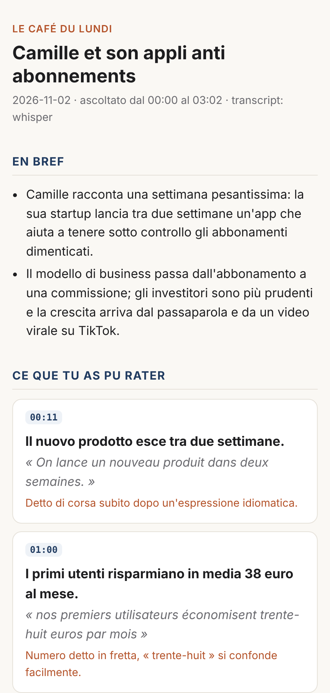
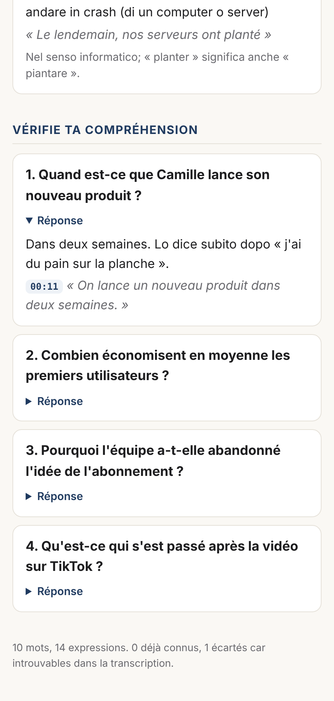
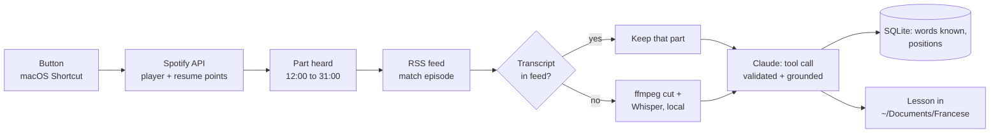

# Entendu

**One button on my Mac turns the French podcast I heard on the metro into a short lesson.**

[](https://github.com/giacomomancarizza/entendu/actions/workflows/tests.yml)

<p>
  
  
</p>

## Why I built it

Every morning I listen to a French podcast on the metro before work. Between the noise, the
crowd and being tired, I miss part of what is said, and the expressions I don't know fly by.
Now, when I get to the office, I press one button: a lesson on exactly what I heard is waiting
in my "Francese" folder, with a summary, the passages I probably missed, new words and idioms,
and a few questions to check I understood.

## What happens when I press the button

1. **Spotify: what did I hear?** The script reads the episode in my player (even paused) and
   my resume points. Comparing them with the positions saved at the previous run, it knows
   the episode and **the part I heard**, for example from 12:00 to 31:00. If it can't tell,
   a small window asks me to pick among the last episodes.
2. **The same episode in the public RSS feed.** Spotify does not share audio or transcripts,
   so the script finds the show's feed (Apple Podcasts directory, no key needed) and matches
   the episode by title and date.
3. **Transcript of that part only.** The publisher's transcript if the feed has one, otherwise
   the audio is cut with ffmpeg (with a margin, since ads can shift positions) and transcribed
   locally with Whisper. Free, and nothing leaves my Mac.
4. **Claude writes the lesson**, block by block: summary, *ce que tu as pu rater* (key
   passages with the minute to rewind to), vocabulary for my level (B2), idioms and slang,
   comprehension questions. Explanations in Italian.
5. **Saved in `~/Documents/Francese`** as HTML and Markdown, then a notification. Words go to
   a local database so the next lessons skip what I already studied; `entendu anki` exports
   them as flashcards.

Example: [lesson](examples/sample-lesson.md) · [Anki deck](examples/sample-anki.txt)



## Design choices

- **Grounding against hallucinations.** For every word, idiom, passage and question the model
  must quote the sentence from the transcript. The code searches for that quote: found, the
  item gets the real timestamp; paraphrased but the word is there, the real sentence replaces
  it; not found, the item is dropped. Timestamps never come from the model.
- **Structured output.** One forced tool call per block with a JSON schema, validated with
  Pydantic; on a validation error the error goes back to the model and it retries once.
- **Only the part I heard.** Cutting the audio keeps transcription to a few minutes and makes
  the lesson about my commute, not the whole episode.
- **Spotify has no podcast history**, so the script keeps its own: resume points saved at each
  run. The first run, with no history, uses the last 40 minutes heard.
- **Tests caught a real bug**: with numbered titles ("Ep 1", "Ep 2") the publication date
  outweighed the title and matched the wrong episode. Now an identical title always wins and
  the date only breaks ties.
- **Everything is testable offline**: fake Spotify client, local feed, replay of recorded
  model responses. 28 tests, and CI runs the whole button flow without network.

Cost: a 30 minute part is about 4 blocks, a few cents with Claude Sonnet. Whisper is free.

## Setup

About 15 minutes, once: [docs/setup-mac.md](docs/setup-mac.md) (install, Claude key, Spotify app,
the Shortcut). Then:

```bash
entendu lesson --dry-run   # what Spotify sees and which feed episode matches, no download
entendu lesson             # the full lesson (this is what the button runs)
entendu anki               # new flashcards since last export
entendu stats
```

Try it offline, no keys:

```bash
pip install -e ".[dev]" && pytest
entendu process "Le Café du Lundi" --transcript examples/cafe-du-lundi.vtt \
  --replay tests/fixtures/sample_notes.json --chunk-minutes 1.5
```

## Project structure

```
src/entendu/
  spotify.py      player, resume points, which part I heard
  match.py        find the RSS feed and the matching episode
  feeds.py        RSS parsing, publisher transcripts, download
  audio.py        cut the part heard (ffmpeg)
  transcribe.py   Whisper, local
  transcript.py   VTT / SRT / JSON / text, chunking
  extract.py      Claude tool call, validation, retry, grounding
  store.py        SQLite: studied words, Spotify positions
  render.py       lesson as HTML and Markdown
  macos.py        notification, picker window
  anki.py         flashcards
  cli.py          entendu lesson | process | episodes | anki | stats
```

## Limitations and next steps

- Spotify exclusive shows have no public feed, so they can't be used.
- Whisper can mishear fast speech; the prompt asks to skip words that look like recognition errors.
- Measure quality on a few hand labelled episodes.
- Resurface words from older lessons when they come back in a new episode.

## License

MIT
